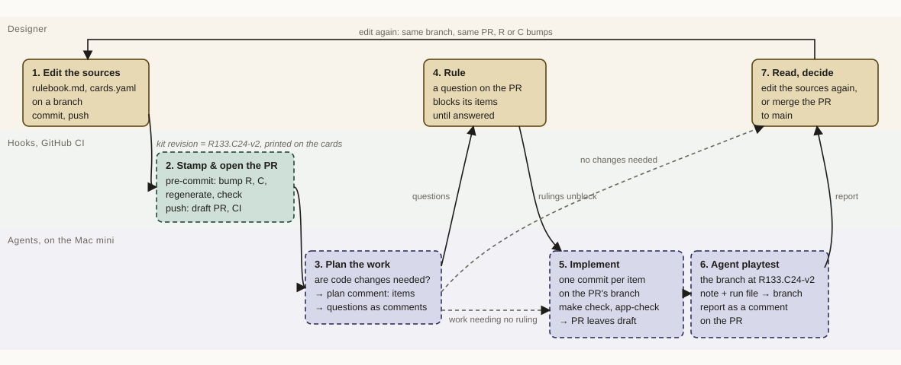

# The design loop

How a change to the sources of truth becomes code, gets playtested, and comes back to the designer. One turn of the loop is one push to a branch, and one source edit is one PR.

`[you]` marks the designer's rulings. `[agent-proposed]` marks details filled in by an agent and not yet ruled on. Replaces the pi game factory plan (PR #253, closed).

## The seven steps

**1. Edit the sources.** The designer, or an agent the designer directs, edits `rulebook.md` or `cards.yaml` on a branch and commits. `[you]`

**2. Stamp and open the PR.** The pre-commit hook bumps the counter for whichever source changed, regenerates the card modules and checks them. The push opens a draft PR from the branch to `main` if none is open, and CI runs `make check` and `make app-check`. `[you]` While the PR changes only the sources and the card modules generated from them, CI skips `make app-check`: the app's tests are expected to fail until the code lands. `[you]` The PR is opened on push rather than at commit time because a hook runs before anything exists on GitHub. `[agent-proposed]` A push whose newest commit skipped the hooks, from the GitHub web editor or the "Update branch" button, gets one more commit from `nvu-bot` that raises R or C and regenerates the card modules. The PR and the plan wait for that commit. `[agent-proposed]` This PR is where the rest of the loop happens: the plan, the questions, the code and the playtest all land on it, and nothing else is opened. `[you]`

**3. Plan the work.** The push starts the *planner*, an agent that reads what changed in the sources, since `main` on the first push and since its last plan after that, and decides whether code changes are needed. `[you]`

- The plan is one comment on the PR. `[you]` It opens with what the diff changes and whether code must change, then lists the work as *items*, one per piece an agent can build and test on its own, each with a stable slug, what the sources now say against what the code does, and an "Acceptance criteria" checklist. A plan that needs no code says so in one sentence. The comment ends with the marker `<!-- nvu-loop: plan <sha> -->` naming the commit it read, so the next plan reads from there and a retry that finds the marker posts nothing. `[agent-proposed]`
- A question is its own comment on the PR, before the plan. It asks one thing, offers the choices the planner sees and recommends one, with no background, consequences or links unless the designer asks. An item that waits on a question says so and is not built until the answer is in. `[you]`
- Every plan restates the whole plan as it stands, not a delta: items still to do, items built already, and nothing for work a source edit made moot. Work that is built already and then dropped by a source edit gets a new item to revert its commit. `[agent-proposed]`
- It reads the sources, the engine, the tests and the PR's thread. It writes comments on the PR and nothing else, and the job holds it to that with a tool allowlist, not only the prompt. It runs on Opus. `[you]`

**4. Rule.** The designer answers a question as a comment on the PR. `[you]` Every comment from the designer on the PR, in the conversation or on the diff, runs the planner again, and the planner sorts it: an answer unblocks its items; a request for an adjustment within what the sources say becomes a new item; a request that would change what the rules or cards say gets a reply that it belongs in the sources on the branch, where the next push plans it; anything else changes nothing and the planner says so in one line. `[you]` So the designer can ask for changes on a green PR by commenting, not only by editing the sources. A PR with a new item goes back to draft until it is built. `[agent-proposed]`

**5. Implement.** The *coder* builds each item of the newest plan that waits on no question as one commit on the PR's branch, titled `Item <slug>: <title>`, and pushes it. It runs after every plan, on Sonnet, in the same job. `[you]` When every item has its commit and both `make check` and `make app-check` pass, the job marks the PR ready for review and comments with each criterion and where it holds; otherwise the PR stays a draft and the comment says what is missing or failing. `[you]`

- The coder sees one item at a time. It edits files and runs the checks; it has no git write access and may not edit `rulebook.md`, `cards.yaml`, the generated card modules or `.github/`. It may change the generator, `tools/cards.mjs`; the job rebuilds the generated modules from the sources before it commits, so the commit carries what the generator writes. The job commits its working tree. A check that another item of the same plan will fix is reported, not fixed, and the job judges the checks once all items are in. `[agent-proposed]`
- Agents never rewrite a commit once it is pushed: no amend, squash, rebase or force-push. A pushed commit may already be named by a kit revision, a plan or a comment marker, and v counts commits. This holds for the coder's commits, the playtest's commits and an agent's source edits alike. `[you]`
- The checks are the review. There is no reviewer agent and no approval: a PR that is ready for review has every item built and both checks green, and the designer reads the diff. `[you]`

**6. Agent playtest.** Optional, and run only when the designer asks by putting the `playtest` label on the PR; the job takes the label off when it ends, so adding it again asks for another run. `[you]` One run, source-blind, through `bin/nvu play` on the branch as it stands. Blind means the skill's rule plus denied reads of `app/src`. It runs on Sonnet. `[you]` The seed is the PR's number times 100 plus the run number. The job, not the agent, commits the note and run file to the branch and posts the report as a comment on the PR, naming the kit revision it played. `[you]`

A richer playtest, with a hypothesis from the planner, a sim comparison against `main` and a report agent, was designed and not built. It is not part of the loop until it is. `[agent-proposed]`

**7. Read, decide.** The designer reads the PR, the build comment and any playtest report, and either edits the sources again on the branch, which bumps R or C and runs the loop again on the same PR, or merges the PR to `main`. `[you]` It merges with a merge commit, never a squash, so `main` shows the kit revision the playtest named: v skips merge commits, but a squashed PR would count as one commit. Squash merging is disabled on `main`. `[you]` Nothing reaches `main` before the designer merges, so `main` is never red because of the loop. `[you]`

## Kit revision

A kit revision names one playable state of the game: `R133.C24-v2`. It replaces the `0.2.x` rules version printed on the cards. `[you]`

- **R** counts rulebook changes and **C** counts card list changes. Both are stored in the file they count, the `Rules version` line in `rulebook.md` and a line under `meta` in `cards.yaml`, and bumped by the pre-commit hook on every commit that touches the file, so each turn of the loop is playtested under its own kit revision. `[you]` The new value is one more than the higher of the last commit's and `main`'s, which is also how two branches that both reach R133 are resolved at merge. `[agent-proposed]` Where they live `[agent-proposed]`.
- **v** counts engine changes so two playtests of the same R and C on different engine builds can be told apart. It never counts merge commits. `[you]` It is derived from git, not stored: v1 is the engine as it stood when R or C last changed, and each later non-merge commit touching `app/`, excluding the generated card module, adds one. `[agent-proposed]`
- One script prints the full kit revision. The CLI, the run file and the playtest note stamp what it prints. The web build bakes it in at build time. `[agent-proposed]`
- The printable kit is named by R and C alone, `R133.C24`, because nothing printed depends on the engine. The cards and the card sheet's pages carry it. `[agent-proposed]` The PDFs, the card sheet with its backs and the rulebook, are created on a merge to `main` that changes what goes into the kit, on the self-hosted runner so every kit's PDFs come from the same machine. `[you]` They are published as a GitHub release named `kit-R133.C24`. A run started by hand on a branch creates that branch's kit as a run artifact instead. `[agent-proposed]`

## Where it runs

Deterministic CI runs on GitHub-hosted runners. Agents run as jobs on a self-hosted GitHub Actions runner on the designer's always-on desktop Mac, installed as a launchd service; see `docs/agents/runner.md`. `[you]`

The repo is public, so a self-hosted runner is reachable from forks. Fork PR workflows require approval for all external contributors, and every `runs-on: self-hosted` job checks that its event came from this repo and not a fork, for example `github.event.pull_request.head.repo.full_name == github.repository`. `[you]`

Three identities write to the repo, and the split is by kind of work, not by step. `[you]`

- `nvu-bot`, a GitHub App, writes for deterministic work, the workflows that run no agent: `source-pr.yml` opening the draft PR and `kit-fix.yml` committing a raised R or C. It has Contents and Pull requests read/write and Metadata read. `[you]`
- `nvu-agent`, a GitHub App, writes for autonomous agent work, the jobs on the self-hosted runner: the planner's comments, the coder's commits and the ready-for-review change, the playtest's commits and reports. It has Contents, Issues and Pull requests read/write, Actions read and Metadata read, and no Workflows write. `[you]`
- The designer writes as themselves.

Both apps are installed only on this repo and have their webhook off. Each job mints a token from its app with `actions/create-github-app-token`, using the variables `NVU_BOT_APP_ID` and `NVU_AGENT_APP_ID` and the secrets `NVU_BOT_PRIVATE_KEY` and `NVU_AGENT_PRIVATE_KEY`. There is no fallback to `GITHUB_TOKEN`, because a write made with it starts no other workflow: a job whose app is not configured fails. `[you]`

Every agent comments on the PR when it begins and when it ends, so the record of what ran is on GitHub, not only in the runs. `[you]`

The contract that keeps the runner replaceable: every step starts on a GitHub event and ends in GitHub writes, meaning comments, labels, PRs and commits. Nothing downstream reads the runner's own state. Claude Code Routines on a webhook, or a controller, could take the runner's place without changing the loop. `[agent-proposed]`

What GitHub provides, so nothing is built for it: dispatch by `push`, `pull_request`, `issue_comment` and `pull_request.labeled` events; one worker at a time by a concurrency group per PR; the workflow run as the record of an attempt, with the agent transcripts uploaded as a run artifact; cancel and re-run for recovery; a marker in posted comments so a retry does not post twice. `[agent-proposed]`

## The jobs

How each step runs, for whoever changes a workflow. The prompts live in `.github/loop/`; change an agent's behaviour there, in a PR, like code.

- **`source-pr.yml`**, step 2, GitHub-hosted, as `nvu-bot`. On a push to a branch whose sources differ from `main` and that has no open PR, opens the draft PR. A push whose newest commit skipped the hooks (`tools/stale-kit.sh`) gets no PR; `kit-fix.yml` pushes the fixed commit, and that push opens it.
- **`kit-fix.yml`**, step 2, GitHub-hosted, as `nvu-bot`. On a push whose newest commit is stale, raises R or C, rebuilds the card modules and pushes the result as one new commit. It never amends or force-pushes.
- **`ci.yml`** and **`rules-version.yml`**, step 2, GitHub-hosted. Every PR runs `make check`; a PR that changes only the sources and their generated modules skips `make app-check`, any other runs it. The Kit revision check fails a PR whose sources changed without R or C raised.
- **`loop.yml`**, steps 3 to 5, one job on the self-hosted runner, as `nvu-agent`. Its `gate` job, GitHub-hosted, lets through a push to a branch with an open PR to `main` whose sources differ from `main`, that PR's opened event, and any comment from the designer on such a PR, in the conversation or on the diff; a stale commit and a fork never pass. The `loop` job plans, posting the start, the questions and the plan, then builds: it reads the newest plan comment, builds each unblocked item whose commit is not on the branch, runs both checks, and marks the PR ready, or takes it back to draft and says why. A plan that a comment left unchanged is posted as one line with an `unchanged` marker, and the build skips it. The planner has `claude -p --restricted` with Read, Grep, Glob, git's read commands and `gh pr view` and `gh pr comment`; the coder has Read, Grep, Glob, Edit, the two make targets and git's read commands, and may not edit the sources, the generated modules or `.github/`; the job rebuilds the generated modules before each commit, so a changed generator is not taken for an edit to them. Neither has a token or git credentials, and the job fails if the planner changed the checkout. One run per PR at a time, group `loop-<pr>`. A re-run that finds its plan marker plans nothing and builds what is left; an item whose commit exists is skipped. Transcripts are the run's artifact for 30 days.
- **`playtest.yml`**, step 6, self-hosted, as `nvu-agent`. On the `playtest` label on a PR to `main` from this repo. Plays one run on the branch's head, checks that the agent wrote one note and nothing else, replays the run file, commits the note and run file to the branch, posts the report as a PR comment, and takes the label off. A failure comments and takes the label off, so adding it again retries.
- **`printable-kit.yml`**, the kit revision, self-hosted. On a merge to `main` that changes what goes into the kit, creates the PDFs and publishes them as the release `kit-R<n>.C<n>`.

**Recovery.** Re-run the failed run from the Actions tab. Every comment carries a marker, so a re-run posts nothing twice; a coder commit that was pushed is not built again. A planner that filed questions and then failed before the plan was posted re-asks nothing, because the thread holds them.

## Build order

Close the loop with the designer in the middle first, then take the designer out of the parts agents can do. `[agent-proposed]`

1. Step 2: the R and C counters printed on the cards, the engine count, a workflow that opens the draft PR on push, the runner. Done.
2. Step 3: the planner, writing issues. Done, then reshaped to write the plan on the PR.
3. Step 6: the playtest as a job. Done, then reshaped to report on the PR.
4. Step 5: the coder, as commits on the PR. A first version built each item as a layer of a `gh stack` with its own PR and a reviewer agent; no layer ever passed its own checks, because each layer was held to checks that only the whole plan could satisfy, and the stack was dropped for commits on one PR.
5. Step 6 as a change review: a hypothesis from the planner, a sim comparison and a report agent. Not built.

## Not in this loop

Physical playtest kits, publication, balance reports beyond step 6, a workbench, and the issue tracker are not part of the loop and are not blocked by it. Issues the designer files, for UI bugs, workflow changes and enhancements, are worked by hand or with `/take-issue` and `/run-issues` (`docs/agents/issue-tracker.md`); the loop neither reads nor writes them.
